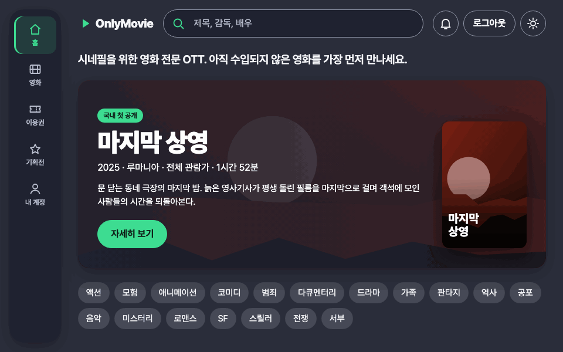
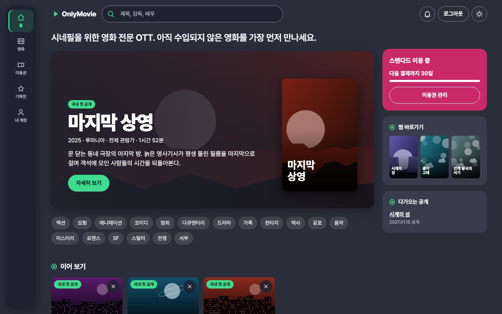
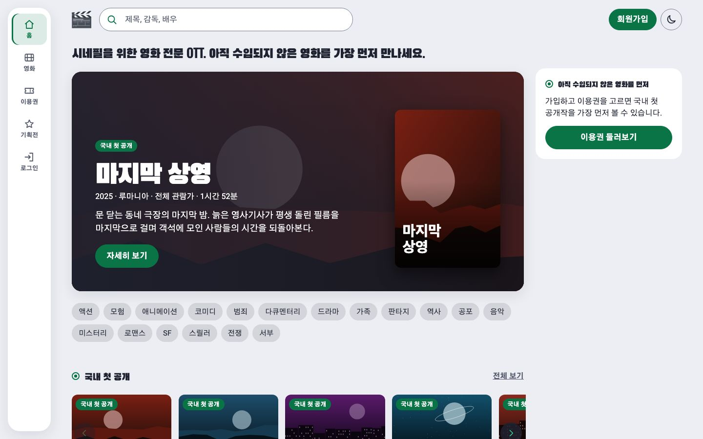
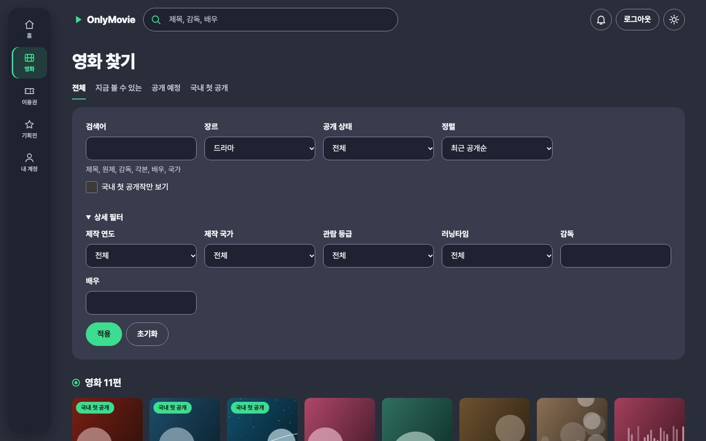
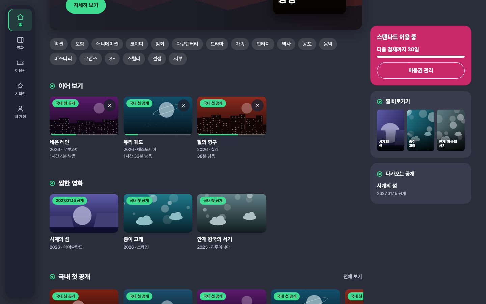
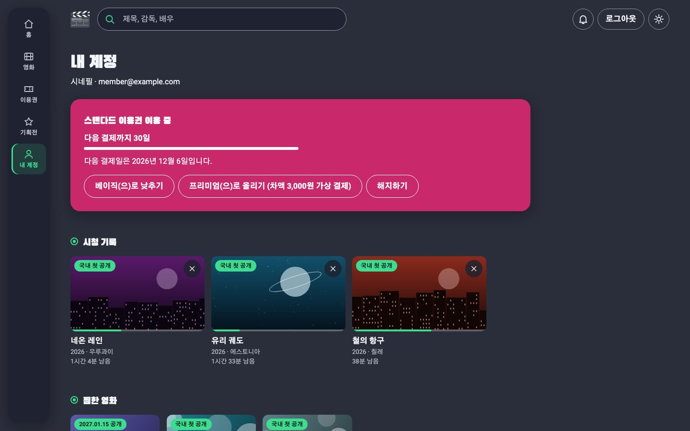
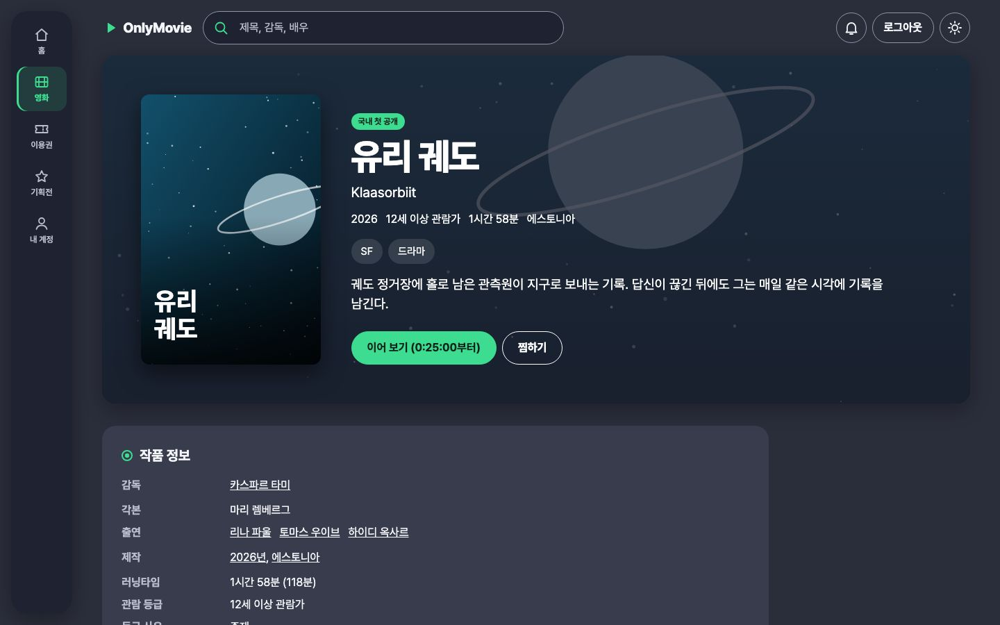
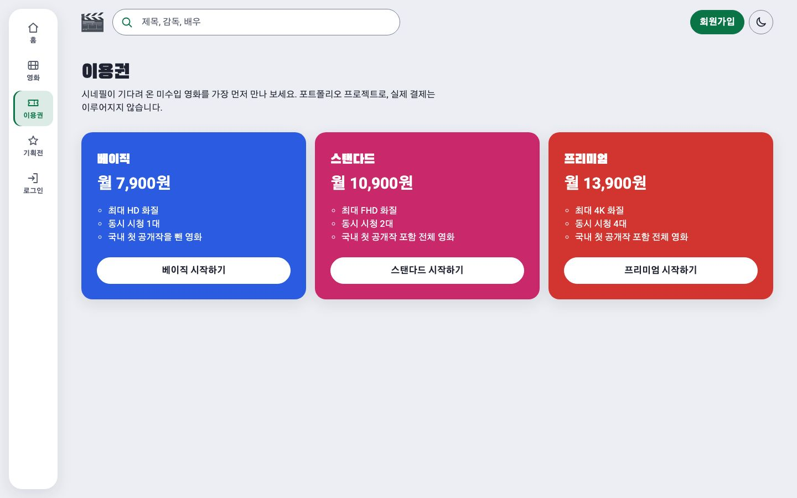
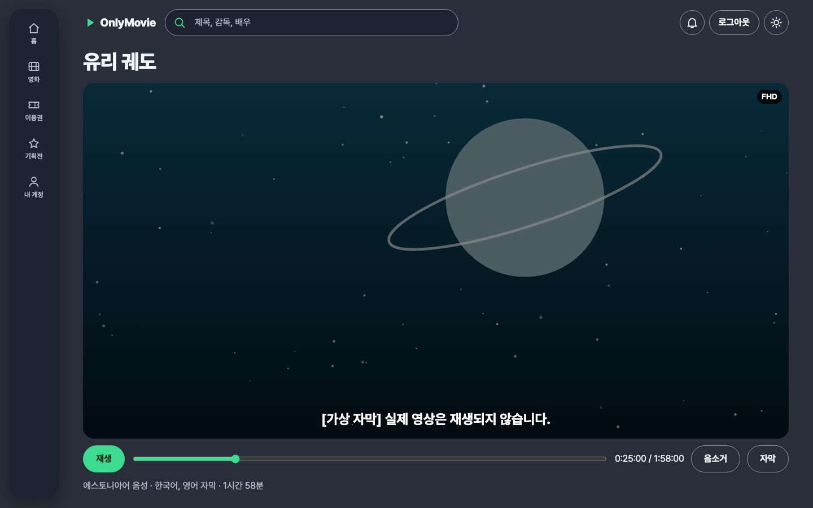

# OnlyMovie

[](https://github.com/ryushin01/OnlyMovie/actions/workflows/ci.yml)
[](https://github.com/ryushin01/OnlyMovie/releases/latest)

시네필을 위한 영화 전문 OTT입니다. 시리즈도 예능도 없이 영화만 다루고, 국내에 수입되지 않은 영화를 누구보다 먼저 들여와 보여 줍니다.

**[사이트 보기](https://only-movie-ryushin.netlify.app/)** · 작품은 가입 없이 둘러보고, 재생은 회원가입과 이용권으로 엽니다.

> **프로젝트 상태:** **포트폴리오 프로젝트**입니다. 실제 서비스가 아니며, 영화와 인물은 모두 가상 데이터입니다. 결제는 실제 돈이 오가지 않는 가상 결제이고, 재생 화면은 권한 확인까지 구현했을 뿐 실제 영상은 나오지 않습니다.

## 화면

화면의 영화와 인물은 모두 가상 데이터이고, 포스터와 배경 이미지는 코드로 그린 것입니다.



| 메인 (다크 모드) | 메인 (라이트 모드) |
|---|---|
|  |  |

| 리스트 | 메인의 이어 보기 |
|---|---|
|  |  |

| 내 계정 | 디테일 |
|---|---|
|  |  |

| 이용권 | 재생 |
|---|---|
|  |  |

## 주요 기능

- **메인 → 리스트 → 디테일**의 3단 구조. 메인은 국내 첫 공개작과 공개 예정작을 앞세움
- 작품 정보: 제목, 원제, 제작 연도, 국가, 장르, 감독, 각본, 출연, 러닝타임, 관람 등급과 등급 사유, 음성·자막 언어, 분위기, 수입 이야기
- 검색: 제목, 원제, 감독, 각본, 배우, 국가. 어느 화면에서든 머리글에서 검색
- 필터: 장르, 제작 연도, 국가, 감독, 배우, 관람 등급, 러닝타임, 공개 상태, 국내 첫 공개작, 정렬. 조건이 주소에 남아 공유와 뒤로 가기가 그대로 동작
- 회원가입(메일 확인), 로그인, 비밀번호 재설정, 회원 탈퇴
- 이용권 3종과 가상 결제: 구독, 정기 결제, 올리기(차액 결제), 낮추기(다음 결제일 예약), 해지 예약과 취소, 만료, 결제 실패, 결제 내역
- 재생 권한은 서버가 확인: 국내 첫 공개작은 스탠다드 이상, 공개 전 작품은 재생 불가
- 재생 화면: 자동 재생 없음, 위치 이동, 자막, 음소거, 이용권별 화질 표시, 키보드 조작
- 이어 보기: 보던 위치를 서버에 저장해 메인과 디테일에서 이어서 재생
- 찜하기: 공개 예정작까지 찜해 메인과 내 계정에서 모아 보기
- 비슷한 영화: 디테일에서 같은 장르의 다른 영화로 이동
- 공개 알림: 공개 예정작에 알림을 걸고 공개되면 머리글의 종에서 확인
- 수입 기획전: 작품을 들여온 이야기와 함께 보는 국내 첫 공개작 모음
- 동시 시청 제한: 이용권별 대수를 서버에서 확인. 시청 기록은 메인과 내 계정에서 지우기
- 스켈레톤 UI: 포스터와 목록을 불러오는 동안 같은 크기의 자리를 표시해 화면이 밀리지 않음. 움직임 줄이기 설정을 따름
- 다크 모드 (처음에는 시스템 설정을 따르고, 고른 값을 기억)

## 기술 스택


| 구분 | 사용 기술 |
|---|---|
| 프레임워크 | React 19, Vite 8, TypeScript 7, TanStack Router |
| 상태·데이터 | TanStack Query v5, zod(API 응답 검증) |
| 서버 | Netlify Functions, Netlify Database (PostgreSQL), Netlify Identity (회원) |
| 스타일 | Emotion, Oswald·Black Han Sans(제목), Roboto·Gothic A1(본문) |
| 품질 | oxlint(jsx-a11y), Prettier, Vitest + React Testing Library, Playwright + axe (Chromium, Firefox, WebKit E2E), size-limit, Lighthouse CI |
| 모니터링 | Sentry(DSN이 있을 때만), web-vitals |
| 배포 | Netlify, GitHub Actions |
| 자동화 | GitHub Actions (CI, 배포 후 사이트 검사), Dependabot |

## 시작하기

Node.js 26(`.nvmrc`)과 pnpm이 필요합니다.

```bash
nvm use
pnpm install
pnpm dev         # http://localhost:5173 (함수와 DB를 로컬에서 흉내 냄)
pnpm db:migrate  # 처음 한 번, pnpm dev를 켠 채로 다른 터미널에서 실행
```

회원 기능은 로컬에서 동작하지 않아 가상의 회원으로 로그인한 것으로 봅니다. 배포 준비는 [개발 가이드](docs/development.md#배포-전-설정)를 참고하세요.

| 명령 | 설명 |
|---|---|
| `pnpm build` | 타입 검사와 프로덕션 빌드 |
| `pnpm typecheck` / `lint` / `format` | 타입 검사 / 린트(접근성, FSD 계층 포함) / 코드 정리 |
| `pnpm test` | 단위·컴포넌트 테스트, 실제 Postgres를 쓰는 서버 테스트 |
| `pnpm test:e2e` | 프로덕션 빌드의 흐름·넘침·접근성 검사 (먼저 `build` 필요) |
| `pnpm size` / `pnpm lhci` | 번들 크기 예산 / Lighthouse 점수 기준 검사 (먼저 `build` 필요) |
| `pnpm test:live` | 배포된 사이트 검사 (`main`에 배포할 때마다 자동 실행) |
| `pnpm screenshots` / `demo-gif` | README 스크린샷 / 시연 GIF 다시 만들기 (먼저 `build` 필요) |

## 프로젝트 구조

[Feature-Sliced Design](https://feature-sliced.design)을 따릅니다. 컴포넌트 옆에 `*.test.tsx`를 둡니다.

```
docs/               개발 가이드, 접근성 점검, README 스크린샷
e2e/                E2E 테스트
netlify/            함수(API), 서버 로직, DB 마이그레이션
public/seed/        가상 영화의 포스터와 배경
scripts/            가상 영화 원고와 시드 생성
src/
├─ app/             진입점, 라우터, 전역 스타일과 테마 색상
├─ pages/           home, movie-list, movie-detail, watch, plans, checkout, account, login, signup, not-found, route-error
├─ widgets/         site-layout (레일 메뉴, 머리글, 본문 바로가기, 바닥글), movie-row (가로 작품 줄), member-panel (내 정보)
├─ features/        search-movies, filter-movies, toggle-watchlist, subscribe, manage-subscription, login, signup, logout, delete-account, toggle-theme
├─ entities/        movie (작품, 검색 조건, 찜과 이어 보기), subscription (이용권, 재생 권한), session (로그인 상태)
└─ shared/          공통 UI, 경로, 유틸리티
```

## 문서

| 문서 | 내용 |
|---|---|
| [개발 가이드](docs/development.md) | 구현 판단, 테스트 구성, 배포 시 유의점, 알려진 제한 |
| [접근성 점검](docs/accessibility.md) | KWCAG 2.2 항목별 자체 점검 결과 |
| [시퀀스 다이어그램](docs/sequence-diagrams.md) | 재생 권한과 동시 시청 제한, 이어 보기 저장, 이용권 바꾸기 |
| [변경 기록](CHANGELOG.md) | 버전별 변경 내용 |

## 출처

| 자료 | 저작자 | 사용 허락 | 원본 |
|---|---|---|---|
| Oswald 글꼴 | The Oswald Project Authors | SIL OFL 1.1 | [googlefonts/OswaldFont](https://github.com/googlefonts/OswaldFont) |
| Black Han Sans(검은고딕) 글꼴 | The Black Han Sans Project Authors | SIL OFL 1.1 | [zesstype/Black-Han-Sans](https://github.com/zesstype/Black-Han-Sans) |
| Gothic A1 글꼴 | HanYang I&C | SIL OFL 1.1 | [Google Fonts](https://fonts.google.com/specimen/Gothic+A1) |
| Roboto 글꼴 | The Roboto Project Authors | SIL OFL 1.1 | [googlefonts/roboto-classic](https://github.com/googlefonts/roboto-classic) |

포스터와 배경 이미지는 코드로 그렸고, 영화와 인물은 가상 데이터입니다.
